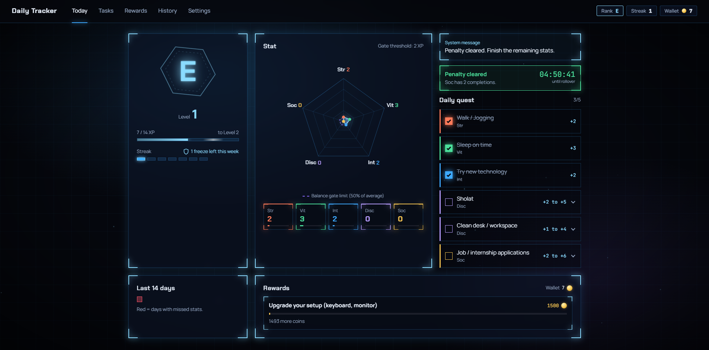
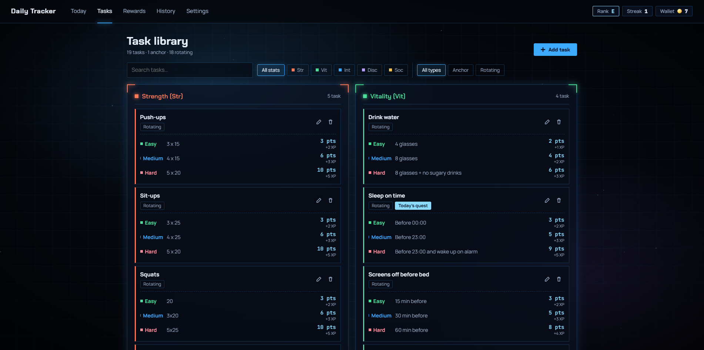
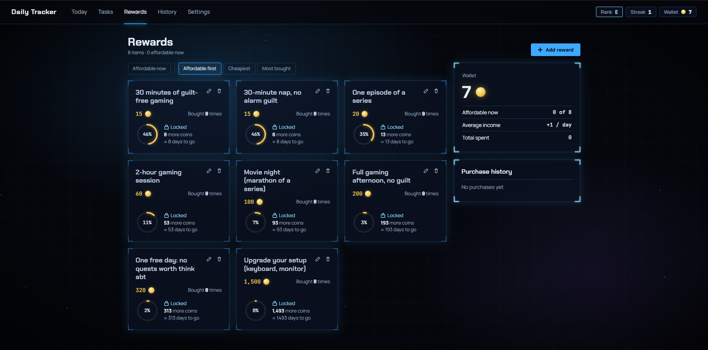
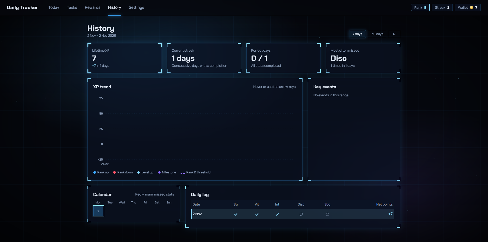
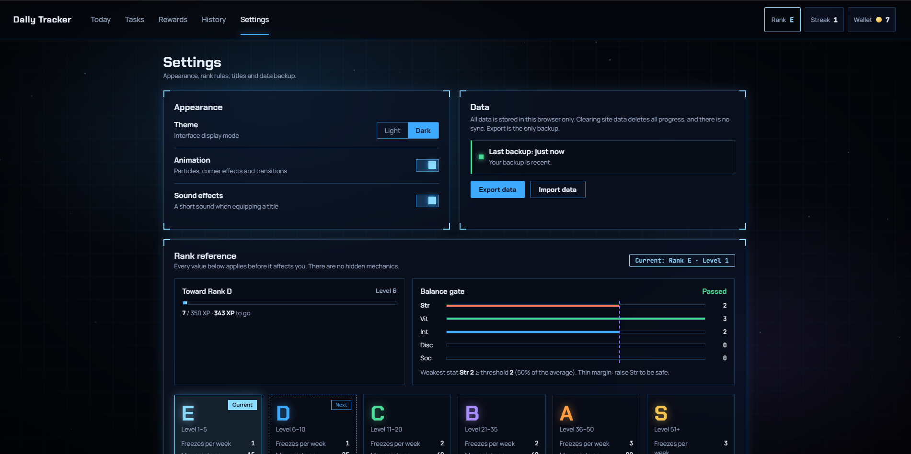
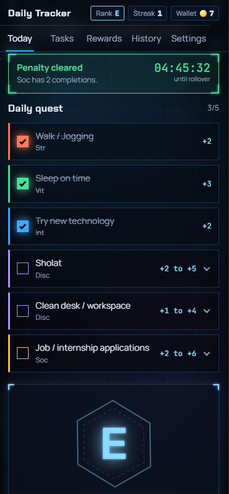
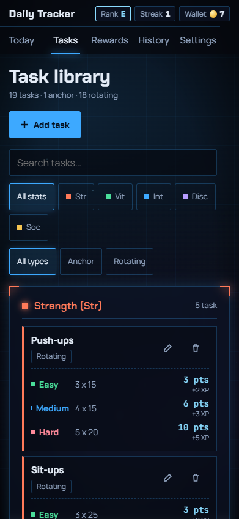
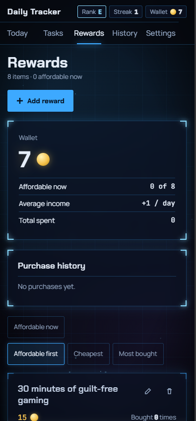
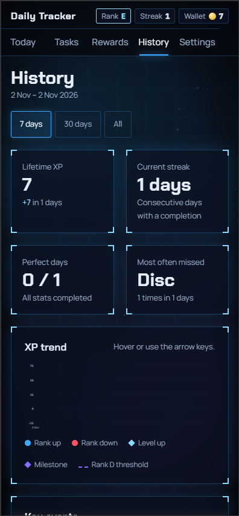
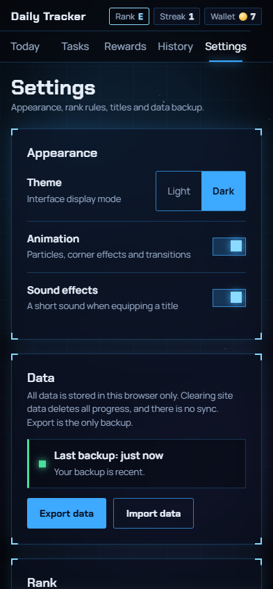

# Daily Tracker

A gamified daily habit tracker with a Solo Leveling style "system window" interface. Complete daily quests across five stats, earn XP, level up, climb from Rank E to Rank S, and spend coins on rewards you define yourself. Everything runs in the browser and your data stays on your device.

[](https://github.com/Deqii/daily-tracker/actions/workflows/visual.yml)



## Screenshots

All screenshots use the built-in demo data (Rank E, Level 3), not real user data.

| Today                                                                                      | Tasks                                                                                    |
| ------------------------------------------------------------------------------------------ | ---------------------------------------------------------------------------------------- |
|        |      |
| **Rewards**                                                                                | **History**                                                                              |
|    |  |
| **Settings**                                                                               |                                                                                          |
|  |                                                                                          |

<details>
<summary>Mobile (390 px wide)</summary>

<p>
  
  
  
  
  
</p>

</details>

## Features

- **Daily quest.** Every day you complete at least one task in each of five stats: Strength, Vitality, Intellect, Discipline and Social. Tasks are either anchors (always shown) or rotating (one is picked per day), and a task can have up to three effort tiers (easy, medium, hard) with their own points.
- **Progression.** XP raises your level (the XP needed for level N is 14 x (N-1)^2), and levels unlock ranks E to S. Each rank changes your point multiplier, the penalty for a missed stat, the per-task point cap and the number of weekly streak freezes.
- **Balance gate.** A rank-up is blocked until your weakest stat reaches at least half of the average, so you cannot level a single stat and skip the rest. The Today page shows the gate as a polygon on the radar chart.
- **Penalties and streaks.** A missed stat costs XP and doubles that stat's requirement the next day. A day counts toward your streak when you complete at least one task, and weekly freezes protect the streak on a day with no completions.
- **Rewards and wallet.** Coins equal the points you earn. Create rewards with your own price, buy them as often as you like, and review your purchase history. Buying only lowers the wallet, never your XP or stats.
- **History.** An XP trend chart with rank, level and milestone markers, a calendar, and a daily log with freeze and pending states.
- **Titles.** Nine cosmetic titles that unlock from streaks, rank, completed tasks and your first purchase.
- **Your data, your device.** Data is stored in `localStorage`. Export and import a versioned JSON backup from Settings; the app reminds you when your last backup is more than a week old.
- **Dark and light themes**, plus a motion switch and full `prefers-reduced-motion` support.

### Ranks

| Rank | Levels | Freezes per week | Max points per task | Point multiplier | Penalty per missed stat |
| ---- | ------ | ---------------- | ------------------- | ---------------- | ----------------------- |
| E    | 1-5    | 1                | 15                  | x0.5             | 5                       |
| D    | 6-10   | 1                | 25                  | x0.7             | 8                       |
| C    | 11-20  | 2                | 40                  | x0.85            | 13                      |
| B    | 21-35  | 2                | 60                  | x1.0             | 20                      |
| A    | 36-50  | 3                | 90                  | x1.15            | 30                      |
| S    | 51+    | 3                | no cap              | x1.3             | 45                      |

This is a summary. The full rules live in [`docs/PRD.md`](docs/PRD.md).

## Tech stack

- Svelte and TypeScript, built with Vite. Hash routes (`#/today`, `#/tasks`, `#/rewards`, `#/history`, `#/settings`).
- A framework-free rules engine in `src/lib/engine` (points, ranks, gate, streaks, penalties), tested with Vitest.
- Plain CSS ported from HTML prototypes: design tokens, per-page styles scoped with `@scope`, dark and light themes.
- Chakra Petch, Manrope and JetBrains Mono through `@fontsource`.
- Playwright for the visual fidelity suite.

## Getting started

Requirements: Node 22 and npm.

```bash
npm ci
npm run dev        # http://localhost:5173
```

Production build:

```bash
npm run build
npm run preview
```

## Scripts

| Script                                  | What it does                                                  |
| --------------------------------------- | ------------------------------------------------------------- |
| `npm run dev`                           | Start the Vite dev server                                     |
| `npm run build` / `npm run preview`     | Production build and local preview                            |
| `npm run check`                         | Type and Svelte checks                                        |
| `npm run lint` / `npm run format:check` | ESLint and Prettier                                           |
| `npm test`                              | Unit tests (Vitest)                                           |
| `npm run build:visual`                  | Build with demo fixtures enabled (visual mode, never shipped) |
| `npm run test:visual`                   | Full visual fidelity suite (slow, runs in CI)                 |
| `npm run test:visual:page -- <page>`    | Visual tests for one page                                     |
| `npm run test:visual:quick`             | Every page at 1280x800, dark theme only                       |
| `npm run check:no-fixtures`             | Fails if demo-fixture code reaches the production build       |
| `npm run check:fixtures`                | Fails if a fixture drifts from its prototype                  |
| `npm run check:ui-css`                  | Fails if ported CSS differs from the prototypes               |
| `npm run check:prototype-shared`        | Fails if shared rules differ between prototypes               |
| `npm run check:ci-coverage`             | Fails if a visual test is not run by any CI shard             |
| `npm run screenshots`                   | Regenerate the README images in `docs/screenshots`            |

## How the interface is verified

The interface was designed as five standalone HTML prototypes in [`docs/prototype`](docs/prototype), which are the visual specification. The Svelte app must match them exactly:

- The Playwright suite renders each prototype and the matching app page with the same data, clock, fonts and viewport, then compares the pixels and the computed CSS of every element, in two viewports and two themes.
- Demo data for the tests is generated from the prototypes, never copied by hand, and is compiled out of the production build.
- Interaction tests perform the same actions on both sides (opening drawers, buying a reward, completing a quest) and compare the results.
- Intentional differences are recorded in [`docs/prototype/DEVIATIONS.md`](docs/prototype/DEVIATIONS.md). Details of the harness are in [`tests/visual/README.md`](tests/visual/README.md).

## Project structure

```text
src/
  components/    shared UI such as the app shell
  pages/         Today, Tasks, Rewards, History and Settings
  lib/engine/    rules engine (no UI code)
  lib/fixtures/  demo data for visual tests (visual build only)
  styles/ui/     global and per-page CSS ported from the prototypes
docs/
  prototype/     HTML prototypes and the deviations log
  screenshots/   README images
tests/visual/    Playwright fidelity suite and harness
scripts/         checks, fixture generators and the screenshot script
```

## Updating the screenshots

The README images are generated from the built-in demo data so that they are reproducible:

```bash
npx playwright install chromium   # once
npm run screenshots
```

The script builds the visual bundle, serves it locally and writes 15 PNG files to `docs/screenshots` (five pages, dark, light and mobile). Commit the changed images together with the UI change.

## Documentation

- [`docs/PRD.md`](docs/PRD.md): product rules and requirements.
- [`docs/prototype/`](docs/prototype): the visual specification and [`DEVIATIONS.md`](docs/prototype/DEVIATIONS.md).
- [`tests/visual/README.md`](tests/visual/README.md): how the fidelity suite works and how to read a failure.
